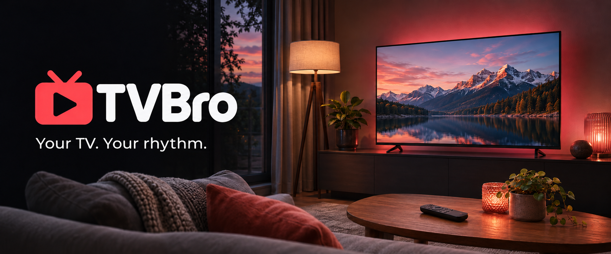
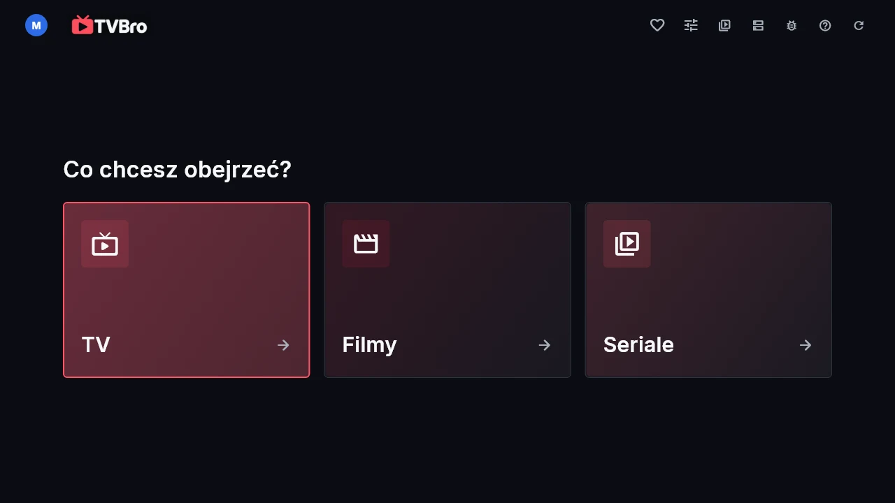
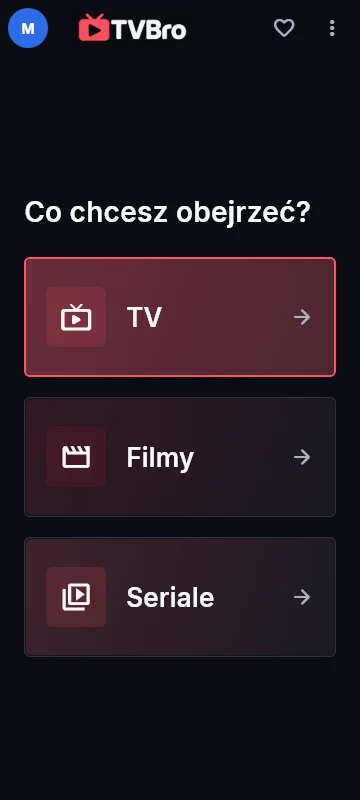

# TVBro



TVBro is an IPTV player for your TV, phone and computer. Add your own playlist
and watch live TV, movies and series in one place.

[Download TVBro](https://github.com/Fusion231/tvbro/releases) ·
[App website](https://tvbro.online/) ·
[Help](https://tvbro.online/support)

## Watch your way

- **Find something for tonight.** Browse the TV guide, see what's on later,
  or search for a specific channel, movie or series.
- **Keep your favourites close.** Save channels, create your own groups and
  arrange them the way you like. Hide anything you don't need.
- **Take a break.** Enable timeshift to pause a live channel and return to
  the recorded segment.
- **Save a show for later.** Record it on your device or schedule a recording
  from the TV guide.
- **Add a playlist from your phone.** Enter your details in the account panel
  and pair your TV with a code or QR code. No need to type a long playlist URL
  with your remote.

## On the sofa and at your desk

Use TVBro on **Windows, Android and Android TV / Google TV**.
Navigate with a remote on your TV, touch on your phone, or a mouse and keyboard
on your computer. The interface is available in Polish and English.

## See TVBro

| On the big screen | On your phone |
| --- | --- |
|  |  |

## Start watching

1. Download the version for your device.
2. Add a playlist or account from your provider.
3. Choose a channel, movie or series.

TVBro supports **M3U/M3U8 playlists, Xtream Codes and Stalker Portal**.
You can also try demo mode first to explore the app.

You need your own playlist or provider account to watch.
TVBro does not include a TV subscription or channel package.
TV guide data and catch-up availability depend on your provider.

## What's free

Basic playback, the TV guide and manual recording are free.
Supporter adds recurring recordings, automatic syncing of settings and
favourites, and resuming movies and series from your saved position.
[Supporter details](https://tvbro.online/).

## Downloads and help

Find the version for your device on the
[TVBro releases page](https://github.com/Fusion231/tvbro/releases).
On Windows, extract the entire package and run the app from its folder.

Recording and timeshift require free space on your device.
The device and app must be running during a scheduled recording.

Samsung and LG TV versions are being tested.
[Current platform availability](docs/platform-capabilities.md).

[Setup help](https://tvbro.online/support) ·
[Report a problem](https://github.com/Fusion231/tvbro/issues)

## Build the application

Requires Flutter 3.47.7 (Dart 3.13.5), Git LFS and the platform's normal Flutter
toolchain. Windows also needs Visual Studio C++ tools; Android needs its SDK
and a compatible JDK. These sources do not require the private backend to build.

```sh
git lfs install
git lfs pull
cd clients/player
flutter pub get
flutter analyze
flutter test
flutter build windows --debug --dart-define=DISTRIBUTION_CHANNEL=development
flutter build apk --debug --flavor development --dart-define=DISTRIBUTION_CHANNEL=development
```

Run the build command for your platform. Windows builds require Windows;
iOS/macOS builds require macOS and Xcode. Keep the real LFS AAR, local iOS plugin,
native source patches and third-party notices with the source tree.

- `clients/player/` contains the Flutter app and native platform integrations.
- `clients/tv/` contains Samsung Tizen, LG webOS and Titan OS application clients.
- `panel/src/{pin,crypto,validate}.js` are shared client protocol/build inputs.
  The account panel and website are not included in this public source tree.
- `scripts/` contains local application build and verification tools.

The API and account website are optional runtime services. Basic local playback
can use the demo source or your own provider; cloud features use the configured
TVBro service. SQL/client parity and private release-workflow checks remain in
the private development repository.

See the [TV client build instructions](clients/tv/README.md) for TV web payloads.

## License

TVBro is developed under [GPLv3](LICENSE), based on
[iptvs by GCHOfficial](https://github.com/GCHOfficial/iptvs).
[Code provenance and third-party components](THIRD_PARTY_NOTICES.md).
