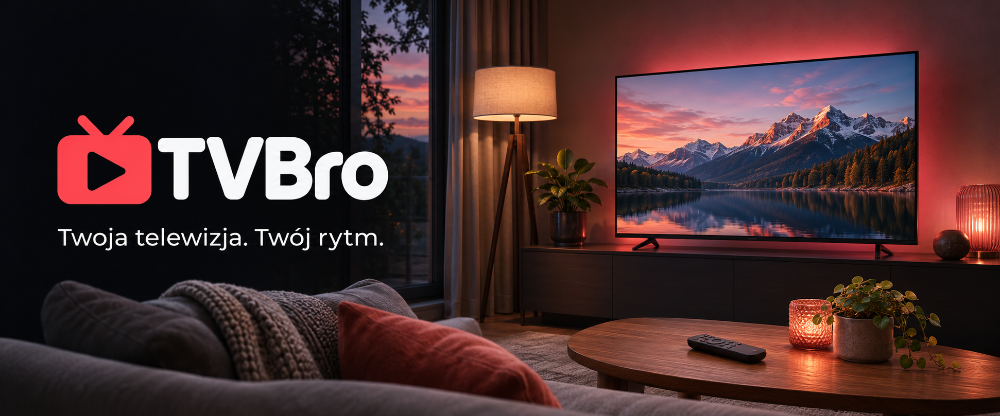

# TVBro

TVBro to odtwarzacz IPTV na telewizor, telefon i komputer. Dodaj swoją listę
i oglądaj telewizję na żywo, filmy oraz seriale w jednym miejscu.

[Pobierz TVBro](https://github.com/Fusion231/tvbro/releases) ·
[Strona aplikacji](https://tvbro.online/) ·
[Pomoc](https://tvbro.online/support)

## Oglądaj po swojemu

- **Znajdź coś na wieczór.** Sprawdź program TV, zobacz, co będzie później,
  albo wyszukaj konkretny kanał, film lub serial.
- **Miej ulubione pod ręką.** Zapisuj kanały, twórz własne grupy i ustaw
  kolejność tak, jak lubisz. Niepotrzebne pozycje możesz ukryć.
- **Zrób przerwę w oglądaniu.** Włącz cofanie transmisji, żeby zatrzymać
  kanał i wrócić do zapisanego fragmentu.
- **Zachowaj program na później.** Nagraj go na swoim urządzeniu albo
  zaplanuj nagranie z programu TV.
- **Dodaj listę przez telefon.** Wpisz dane w panelu i połącz telewizor
  kodem lub przez QR. Długiego adresu listy nie musisz wpisywać pilotem.

## Na kanapie i przy biurku

Korzystaj z TVBro na **Windows, Androidzie oraz Android TV / Google TV**.
Na telewizorze wybieraj pilotem, na telefonie dotykiem, a na komputerze
myszą i klawiaturą. Interfejs jest dostępny po polsku i po angielsku.

## Zobacz TVBro

| Na dużym ekranie | Na telefonie |
| --- | --- |
|  |  |

## Zacznij oglądać

1. Pobierz wersję dla swojego urządzenia.
2. Dodaj listę lub konto otrzymane od swojego dostawcy.
3. Wybierz kanał, film albo serial.

TVBro obsługuje listy **M3U/M3U8, Xtream Codes i Stalker Portal**.
Możesz też najpierw wybrać tryb demo i poznać aplikację.

Do oglądania potrzebujesz własnej listy lub konta u dostawcy.
TVBro nie zawiera abonamentu telewizyjnego ani pakietu kanałów.
Program TV i możliwość oglądania wcześniejszych audycji zależą od dostawcy.

## Co jest bezpłatne

Podstawowe oglądanie, program TV i ręczne nagrywanie są bezpłatne.
Pakiet Supporter dodaje nagrania cykliczne, automatyczną synchronizację
ustawień i ulubionych oraz wznawianie filmów i seriali od zapisanej pozycji.
[Szczegóły Supportera](https://tvbro.online/).

## Pobieranie i pomoc

Wersję dla swojego urządzenia znajdziesz na
[stronie wydań TVBro](https://github.com/Fusion231/tvbro/releases).
Na Windows rozpakuj całą paczkę i uruchom aplikację z jej katalogu.

Nagrywanie i cofanie transmisji wymagają wolnego miejsca na urządzeniu.
Podczas zaplanowanego nagrania urządzenie i aplikacja muszą być włączone.

Wersje dla telewizorów Samsung i LG są w trakcie testów.
[Bieżąca dostępność na urządzeniach](docs/platform-capabilities.md).

[Pomoc w konfiguracji](https://tvbro.online/support) ·
[Zgłoś problem](https://github.com/Fusion231/tvbro/issues)

## Dla osób rozwijających projekt

[Dokumentacja techniczna](docs/development.md) zawiera instrukcje budowania,
opis platform i układ projektu. [Publikowanie wydań](docs/github-releases.md).

## Licencja

TVBro jest rozwijany na [GPLv3](LICENSE) na bazie
[iptvs autorstwa GCHOfficial](https://github.com/GCHOfficial/iptvs).
[Pochodzenie kodu](docs/provenance.md) ·
[Komponenty zewnętrzne](THIRD_PARTY_NOTICES.md).
